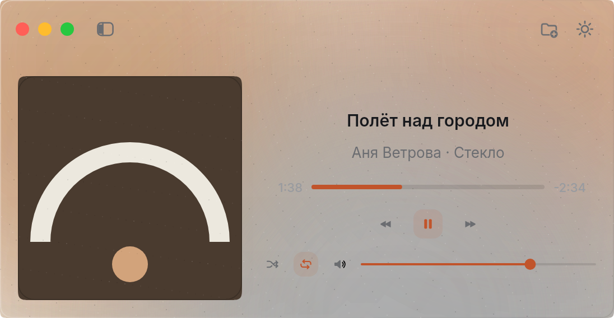
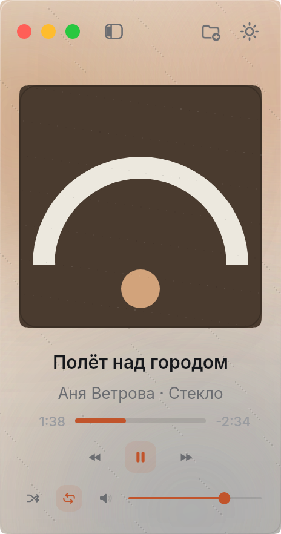
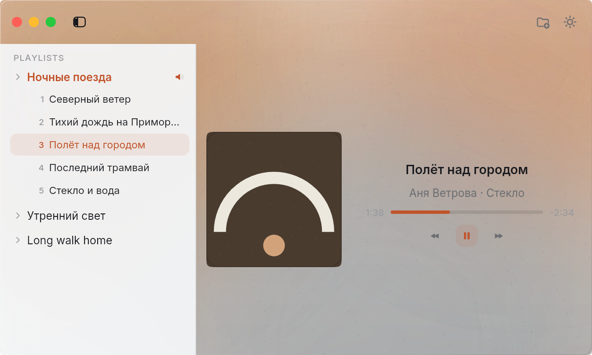
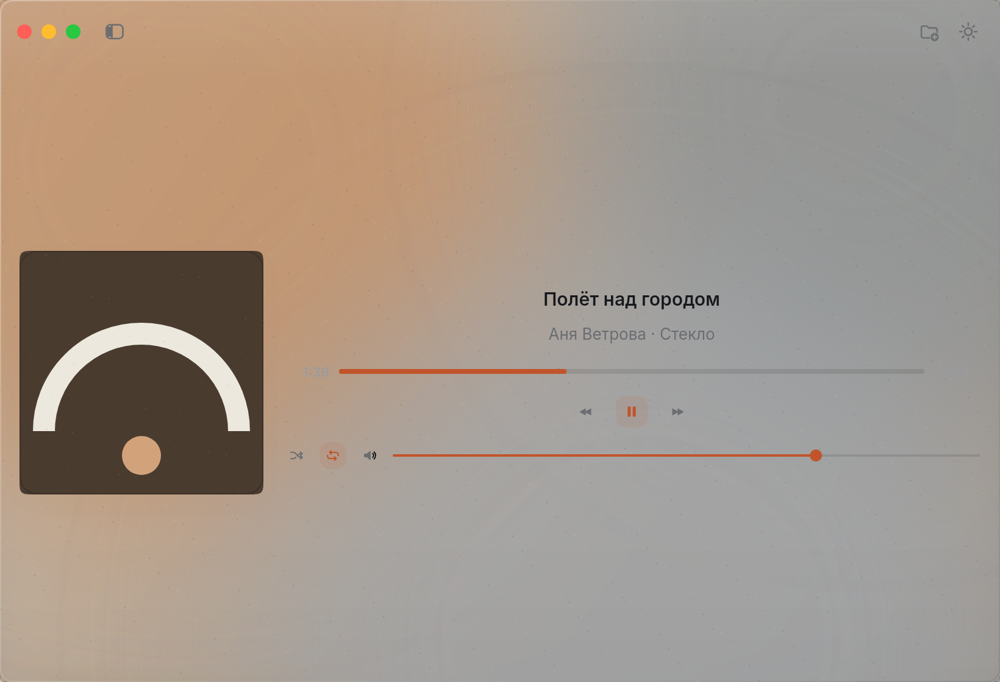
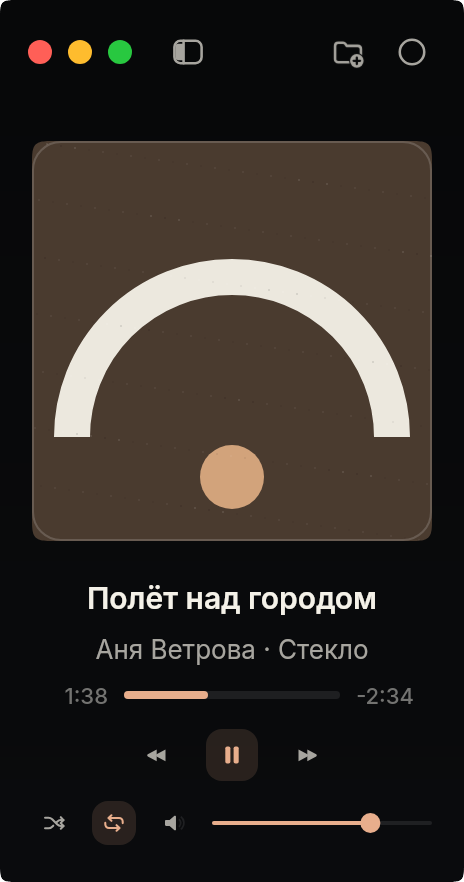

<picture></picture>

# Dajet Player

**Silence, playing.** — a quiet music player for macOS. Native Swift · MIT · free.

Open Dajet Player. Drop a folder of music on it — it plays, in the order the Finder lists it. That is all there is to it, for now.

**🌐 Versions:** [English](README.md) · [Русский](README.ru.md)

## Where it is

**0.1.0 — it lives in the tray, and the window knows its shape.** The project builds with SwiftPM and `./build.sh`, and what they make opens as an ordinary Mac app: one window, a system toolbar of its own, and an icon in the menu bar. A line saying what is playing, Previous and Next, play/pause and Open Folder…, shuffle and repeat, a thin progress bar, a volume slider and a mute button. Drop a folder of music — or a few files, mp3, m4a, flac, wav, aiff — and it plays them one after another, its title, artist and album read from the file, its cover drawn sharp in the middle of the window: from the file's own tags when it has them, from a picture beside it when it does not. A file that will not open is passed over, and the player says so when nothing plays at all. Space stops it and starts it again, the `←` and `→` keys walk the queue, the keyboard's media keys and the Now Playing card in Control Center are the app's own, and at the end of a pass it starts from the top. Volume and mute are remembered between runs.

The look of that window is the `dajet` version of it: glass over the whole of its surface in the light theme — clearer than it was — matte near-black in the dark, and a side menu in the system's split view, beside the player. Inside it are the playlists — folders, added by ⌘O or by being dropped on the window, each one staying in the menu with its tracks under it until it is removed, and still there the next time the player opens. The main window stays a player: the sleeve of what is playing, its name, and the transport beneath it. The toolbar above is the system's own: the menu's toggle beside the traffic lights, Open Folder… and the theme at the other end. The tray menu carries the same things — the current track, the transport, the playlists each with their own submenu, Open Folder…, the theme, settings and Quit — and the tray icon moves while music plays; the music outlives the window. The window will not shrink below a formal square of 232 points; if it is narrow, opening the menu widens it so the sidebar and player fit side by side.

The `joer` skin is still to come; release artifacts can be built, but publication awaits the owner. The queue is in [ROADMAP.md](ROADMAP.md).

## What it looks like

<picture></picture>
<picture></picture>

*Horizontal — 548 × 284, and Vertical — 232 × 441: the two templates the owner measured, glass in the light theme.*

<picture></picture>

*The side menu: playlists, and the tracks of the one that is open — the window stays the player.*

<picture></picture>
<picture></picture>

*Left: the light theme is glass over whatever is behind it. Right: Obsidian — the dark theme, one matte surface.*

## What it is

Dajet Player holds the position the rest of the series does: **a player that stays silent**.

Launch it, open Network Monitor — zero connections. Nothing leaves the machine, and nothing in the app is built to leave it: no telemetry, no accounts, no cloud, no cover art fetched from somewhere, no update check you didn't ask for. Not a promise: a verifiable claim, part of the release checklist.

- Only Apple frameworks: SwiftUI, AppKit, AVFoundation, MediaPlayer, Combine, Foundation, CoreGraphics, CoreImage, ImageIO and UniformTypeIdentifiers — no third-party dependencies
- macOS 14 and later, Apple Silicon first
- One playback core, two skins: `dajet` (dark and light, glass — this wave) and `joer` (the five atmospheres of [joer.ru](https://joer.ru), to come)

## What it can

**P-10R — the window knows its shape.** Two templates the owner measured — Horizontal 548×284 and Vertical 232×441 — and a Custom that is whatever the hand left it as, with no snap back. Appearance is three presets in the tray (Aero, Obsidian, System); the same preset keeps a chosen template, a different one restores its default. Clicking the tray icon hides the window and shows it again; the menu has Shuffle, Repeat, a Volume submenu and a quiet progress read-out. The light glass is clearer, the column is almost opaque, and the tray icon moves at four small steps a second.

**P-10 — the tray, the covers, the window's own minimum.** An icon of the player's own in the menu bar, with a full menu under it: the current track and where it sits in the pass, play/pause/previous/next, the playlists each with a lazy submenu of their tracks, Open Folder…, the theme, settings (hide the Dock icon, animate the tray icon while playing) and Show / Quit. The icon moves only while music plays, and the music outlives the window — close it and the tray keeps playing. Covers come from three places, in order: the file's own tags, the raw bytes of an ID3v2 or FLAC picture, and a file of the same name beside the track (`folder.jpg`, `cover.jpg` and the like) — cached by modification time, so a cover is read once. The toolbar above the window is the system's own: the menu's toggle beside the traffic lights (⌥⌘S), Open Folder… and the theme at the other end — the old band of icons in the window's body is gone. The window will not shrink below a formal square of 232 points of content (232×284 with the toolbar); opening the side menu in a narrow window expands the window to fit both columns, with the sidebar beside the player across the system divider.

**P-06R — the look, and the menu beside it.** The window is glass over the whole of its surface in the light theme — the desktop behind it, blurred, with the lift and the sheen that make a pane read as one — and matte near-black in the dark, with nothing of the desktop in it. The light or the dark is one button in the window's corner, or the Mac's own choice; with Reduce Transparency on, the glass is drawn as a solid pale surface instead. The side menu is a `NavigationSplitView` column alongside the player: the system divider resizes it, and the system toggle beside the traffic lights shows and hides it with the platform's animation. In it are playlists — folders of music, added by ⌘O or by drop, kept in the app's own file in `~/Library/Application Support/Dajet Player/`, removed by hand and only by hand. A folder's tracks are under its name in the menu; click one and it plays, on that folder's queue, with the one being heard marked — and never a wall of rows in the middle of the window, which is the player's and stays the player's.

**P-05 — the system's own controls.** The keyboard media keys are the app's: play, pause, play/pause, next and previous, each one a hand on a button that was already there — play never pauses, pause never starts. The Now Playing card in Control Center and on the lock screen carries the title, artist, duration and progress, and goes away when nothing plays. A thin bar along the foot of the window shows where the track is; dragging it moves the line and not the music, and the track is taken where the hand lets go — even into its very end, which plays itself out by the queue's rules. Volume and mute, remembered between runs. `←` and `→` walk the queue beside Space.

**P-04 — knows what it plays.** Title, artist and album read from the file, a local cover drawn sharp in the middle of the window (the blurred backdrop it faded into was the version before this one: the window is the look now), Next and Previous (Previous restarting a track once its three seconds have gone, otherwise stepping back; on the first track it restarts), shuffle that never repeats a track twice in a pass, and repeat cycling through off, all and one. A file that will not open is passed over, and when nothing that was opened plays, the player says so. What is still ahead:

- **still to come** — the `joer` skin and equalizer (P-07/P-08); the DMG/ZIP/appcast build and release/tap scripts (P-09) are in place, but publication has not happened yet.

## Privacy

| What | Where | Who can read |
|---|---|---|
| Your music | where it already is — never copied, never uploaded | you |
| What the player keeps, from wave 2 on | `~/Library/Application Support/Dajet Player/` | you |
| Everything else | nowhere | — |

## Build from source

```bash
git clone https://github.com/bestdeejay-design/dajet-player
cd dajet-player
./build.sh
```

`build/DajetPlayer.app` — double-click it, or `open build/DajetPlayer.app`. Needs Swift 6 (Xcode command line tools) and macOS 14 or later.

`swift build` on its own gives the plain binary; `./build.sh` is the one that wraps it in the app.

## License

MIT — [LICENSE](LICENSE). Development: [bestdeejay-design/dajet-player](https://github.com/bestdeejay-design/dajet-player).

---

<picture></picture>

*Dajet Player is the second app of the [Dajet](https://github.com/bestdeejay-design/dajet-browser) series: the browser came first, the player follows the same quiet rules.*


## Building

The design layer lives in the **[dajet-ui](https://github.com/bestdeejay-design/dajet-ui)**
package, wired as a local path dependency (`../ui`). Clone both repositories
side by side (`apps/dajet/player` + `apps/dajet/ui`) — a lone clone won't build.
