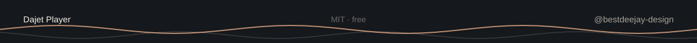

<picture></picture>

# Dajet Player

**Silence, playing.** — a quiet music player for macOS. Native Swift · MIT · free.

Open Dajet Player. Drop a folder of music on it — it plays, in the order the Finder lists it. That is all there is to it, for now.

**🌐 Versions:** [English](README.md) · [Русский](README.ru.md)

## Where it is

**v0.2.0 — knows what it plays.** The project builds with SwiftPM and `./build.sh`, and what they make opens as an ordinary Mac app: one window, no toolbar, no sidebar; a line saying what is playing, Previous and Next, play/pause and Open Folder…, shuffle and repeat. Drop a folder of music — or a few files, mp3, m4a, flac, wav, aiff — and it plays them one after another, its title, artist and album read from the file, its cover blurred behind the window; a file that will not open is passed over, and the player says so when nothing plays at all. Space stops it and starts it again, and at the end of a pass it starts from the top.

The keyboard's media keys, progress and volume are the waves that follow; the queue is in [ROADMAP.md](ROADMAP.md).

## What it is

Dajet Player holds the position the rest of the series does: **a player that stays silent**.

Launch it, open Network Monitor — zero connections. Nothing leaves the machine, and nothing in the app is built to leave it: no telemetry, no accounts, no cloud, no cover art fetched from somewhere, no update check you didn't ask for. Not a promise: a verifiable claim, part of the release checklist.

- SwiftUI and AVFoundation, and nothing else — no third-party dependencies
- macOS 14 and later, Apple Silicon first
- One playback core, two skins to come: `dajet` (dark and light, glass) and `joer` (the five atmospheres of [joer.ru](https://joer.ru))

## What it can

**P-04 — knows what it plays.** Title, artist and album read from the file, a local cover blurred and faded in behind the window, Next and Previous (Previous restarting a track once its three seconds have gone, otherwise stepping back; on the first track it restarts), shuffle that never repeats a track twice in a pass, and repeat cycling through off, all and one. A file that will not open is passed over, and when nothing that was opened plays, the player says so. What is coming, in order:

- **P-05** — the keyboard's media keys, a progress bar you can drag, volume that stays where you left it, and the `←` / `→` shortcuts
- **after that** — the two skins, the equalizer, the disk image and the Homebrew tap (P-06…P-09)

## Privacy

| What | Where | Who can read |
|---|---|---|
| Your music | where it already is — never copied, never uploaded | you |
| What the player keeps, from wave 2 on | `~/Library/Application Support/Dajet Player/` | you |
| Everything else | nowhere | — |

## Build from source

```bash
git clone https://github.com/bestdeejay-design/dajet-player
cd dajet-player
./build.sh
```

`build/DajetPlayer.app` — double-click it, or `open build/DajetPlayer.app`. Needs Swift 6 (Xcode command line tools) and macOS 14 or later.

`swift build` on its own gives the plain binary; `./build.sh` is the one that wraps it in the app.

## License

MIT — [LICENSE](LICENSE). Development: [bestdeejay-design/dajet-player](https://github.com/bestdeejay-design/dajet-player).

---

<picture></picture>

*Dajet Player is the second app of the [Dajet](https://github.com/bestdeejay-design/dajet-browser) series: the browser came first, the player follows the same quiet rules.*
